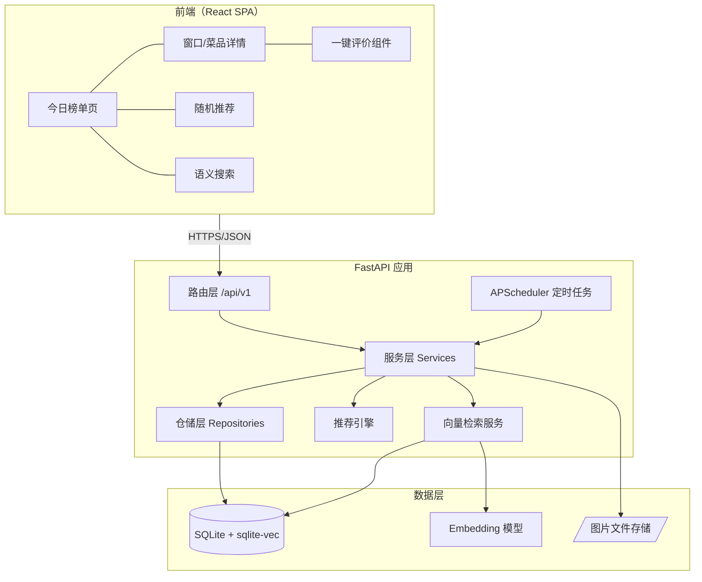
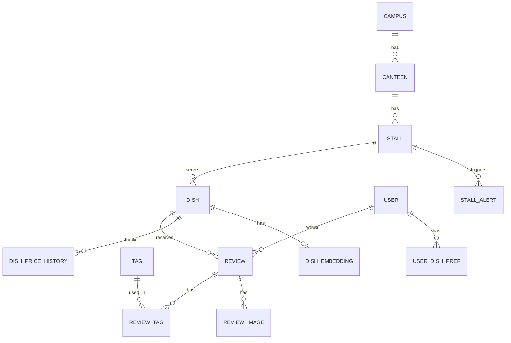

# 校园食堂点评推荐系统 — 项目架构设计

> 版本：v0.1（MVP 阶段）  
> 日期：2026-11-09  
> 状态：草案，待评审

---

## 1. 项目概述

### 1.1 背景与目标

大学生每天面临 2–3 次"食堂吃什么"的决策，但缺乏针对校园食堂的菜品级评价与推荐工具。本系统的目标是：

1. **避雷**：让学生在到达食堂前就知道"今天哪个窗口别去"
2. **发现**：低成本地发现新菜品、限时菜、口碑好但人少的窗口
3. **决策减负**：解决选择困难，30 秒内给出"今天吃这个"

### 1.2 核心产品假设

> 学生愿意每天花 5 秒告诉别人"这顿饭怎么样"。

MVP 的所有设计都围绕验证这一假设展开。如果评价行为跑不起来，后面的推荐算法没有数据基础。

### 1.3 与大众点评的本质区别

| 维度 | 大众点评 | 本系统 |
|---|---|---|
| 评价对象 | 店铺 | **窗口 / 菜品** |
| 使用频率 | 低频 | 每天 2–3 次 |
| 决策时间 | 几分钟到几小时 | **30 秒以内** |
| 信息时效 | 月级 | **天级**（换厨师、涨价、今日特供） |
| 核心价值 | 发现 | **避雷 > 发现** |
| 评价成本 | 长文 + 多图 | **5 秒一键评价** |

### 1.4 MVP 范围

**只做四件事**：窗口列表、一键评价、今日榜单（好评榜 / 踩雷榜）、随机推荐。

明确**不做**：关注 / 私信 / 动态流、积分商城、外卖、复杂的用户主页。

---

## 2. 技术选型

### 2.1 总览

| 层 | 选型 | 说明 |
|---|---|---|
| 前端 | **React 18 + TypeScript + Vite** | 见 2.2 关于 React / Vue 的说明 |
| UI 组件 | Ant Design Mobile 或 shadcn/ui + Tailwind | 移动优先，网页端响应式 |
| 状态管理 | TanStack Query（服务端状态）+ Zustand（本地状态） | 避免 Redux 的样板代码 |
| 后端 | **FastAPI（Python 3.11+）** | 异步、自动 OpenAPI 文档、Pydantic 校验 |
| ORM | SQLAlchemy 2.0（async）+ Alembic | 迁移管理 |
| 数据库 | **SQLite**（WAL 模式） | MVP 阶段单机足够，见 2.3 |
| 向量检索 | **sqlite-vec**（SQLite 扩展） | 与主库同进程，零运维，见第 8 章 |
| Embedding | bge-small-zh-v1.5（本地）或 API | 中文菜名/评价语义检索 |
| 缓存 | 进程内 LRU + 定时任务刷新榜单 | MVP 不引入 Redis |
| 任务调度 | APScheduler | 榜单重算、权重衰减、预警检测 |
| 认证 | JWT + 校园邮箱验证码 | 见第 10 章 |
| 图片存储 | 本地文件系统 → 后期对象存储 | 评价配图 |
| 部署 | Docker Compose（Nginx + FastAPI） | 单机部署 |

### 2.2 关于前端框架：React 与 Vue 二选一

需求中提到 "React + Vue"。**同一个项目不建议同时使用两个框架**——会带来双份的构建配置、组件库、状态管理和团队学习成本，且两者解决的是完全相同的问题。

本文档**以 React 为主线**展开，理由：

- 生态更适合与 TanStack Query、shadcn/ui 配合做数据密集型页面
- TypeScript 支持更成熟
- 后续若要做管理后台，React Admin / Refine 等方案更丰富

如果团队更熟悉 Vue，替换为 **Vue 3 + Vite + Pinia + Vant** 即可，本文档的架构、接口、数据模型全部不受影响。

> 如果"React + Vue"的本意是"前台用一个、管理后台用另一个"，也可行，但同样建议统一以减少维护成本。

### 2.3 关于 SQLite 的边界

SQLite 在以下条件下完全够用：

- 单校区、日活 < 5000、写入 QPS < 50
- 开启 WAL 模式后读写不互斥
- 单文件备份极其简单

**需要迁移到 PostgreSQL 的信号**：多校区部署、需要多实例横向扩展、并发写入出现 `database is locked`。SQLAlchemy 抽象层保证迁移成本可控，但 sqlite-vec 需同步替换为 pgvector。

---

## 3. 系统总体架构



### 3.1 分层职责

| 层 | 职责 | 不做什么 |
|---|---|---|
| 路由层 | 参数校验（Pydantic）、鉴权、返回 DTO | 不写业务逻辑 |
| 服务层 | 业务规则、事务边界、调用推荐 / 向量服务 | 不直接写 SQL |
| 仓储层 | 数据访问、查询封装 | 不含业务判断 |
| 推荐引擎 | 评分计算、榜单生成、个性化排序 | 独立模块，可单元测试 |
| 定时任务 | 榜单重算、权重衰减、预警检测、Embedding 更新 | 不响应 HTTP 请求 |

### 3.2 关键设计原则

1. **读多写少，榜单预计算**：榜单每 10 分钟重算一次写入 `ranking_snapshot` 表，首页接口只读快照，不做实时聚合。
2. **评价即数据**：评价表设计为事件流（append-only），所有聚合指标从事件派生，方便后期重算。
3. **时间是一等公民**：所有评分都带时间衰减，一周前的评价对"今天"几乎没有影响。

---

## 4. 项目目录结构

```
campus-canteen/
├── frontend/                       # React 前端
│   ├── src/
│   │   ├── api/                    # 接口封装（按资源划分）
│   │   ├── components/
│   │   │   ├── RatingQuickBar/     # 一键评价组件（核心）
│   │   │   ├── DishCard/
│   │   │   ├── AlertBanner/        # 踩雷预警横幅
│   │   │   └── RandomPicker/       # 随机推荐
│   │   ├── pages/
│   │   │   ├── Home/               # 今日榜单
│   │   │   ├── Canteen/            # 食堂 → 窗口列表
│   │   │   ├── Stall/              # 窗口详情 + 菜品
│   │   │   ├── Dish/               # 菜品详情 + 评价流
│   │   │   ├── Search/             # 语义搜索
│   │   │   └── Me/                 # 我的评价
│   │   ├── stores/                 # Zustand（筛选条件、用户信息）
│   │   ├── hooks/
│   │   └── types/                  # 与后端 schema 对齐的 TS 类型
│   └── vite.config.ts
│
├── backend/
│   ├── app/
│   │   ├── main.py                 # 应用入口
│   │   ├── core/
│   │   │   ├── config.py           # 配置（pydantic-settings）
│   │   │   ├── security.py         # JWT、密码/验证码
│   │   │   └── database.py         # 引擎、Session、sqlite-vec 加载
│   │   ├── models/                 # SQLAlchemy ORM
│   │   ├── schemas/                # Pydantic 请求/响应
│   │   ├── repositories/           # 数据访问
│   │   ├── services/
│   │   │   ├── review_service.py
│   │   │   ├── ranking_service.py
│   │   │   ├── alert_service.py
│   │   │   └── auth_service.py
│   │   ├── recommender/            # 推荐引擎（独立包）
│   │   │   ├── scoring.py          # 评分公式、时间衰减
│   │   │   ├── ranking.py          # 榜单生成
│   │   │   ├── personalize.py      # 协同过滤 / 情境过滤
│   │   │   └── random_pick.py
│   │   ├── vector/
│   │   │   ├── embedder.py         # Embedding 抽象（本地/API 可切换）
│   │   │   └── search.py           # sqlite-vec 查询
│   │   ├── tasks/                  # APScheduler 任务
│   │   └── api/v1/                 # 路由
│   ├── alembic/
│   ├── tests/
│   └── pyproject.toml
│
├── data/
│   ├── seed/                       # 种子数据（食堂、窗口、菜品 CSV）
│   └── canteen.db                  # SQLite 文件（gitignore）
├── docker-compose.yml
└── README.md
```

---

## 5. 数据模型

### 5.1 实体关系



### 5.2 核心表设计

#### 组织结构

```sql
campus        (id, name, created_at)
canteen       (id, campus_id, name, floors, open_hours_json, is_active)
stall         (id, canteen_id, floor, name, cuisine_type, position_desc,
               is_active, today_status)      -- today_status: open / closed / unknown
dish          (id, stall_id, name, price_cents, spicy_level 0-3,
               is_veg, portion_hint, dish_type,  -- 常驻 / 限时 / 每周X
               is_active, created_at)
dish_price_history (id, dish_id, price_cents, reported_by, confirmed_count, effective_at)
```

#### 用户

```sql
user          (id, campus_id, email_hash, nickname, avatar_seed,
               trust_score DEFAULT 1.0,      -- 防刷用，见第 10 章
               created_at, last_active_at)
```

> 不存学号明文，只存校园邮箱的哈希用于唯一性校验。

#### 评价（核心，append-only）

```sql
review        (id, user_id, dish_id, stall_id,          -- stall_id 冗余，便于聚合
               verdict  CHECK(verdict IN ('good','ok','bad')),
               comment  TEXT NULL,                       -- 可选，限 100 字
               meal_slot CHECK(meal_slot IN ('breakfast','lunch','dinner','night')),
               created_at,
               is_hidden DEFAULT 0)                      -- 软删除/审核隐藏

tag           (id, code, label, category)                -- category: taste / price / portion / service / change
                                                         -- 例：portion_less "份量少了", price_up "涨价了",
                                                         --     chef_changed "换厨师了", queue_long "排队久"
review_tag    (review_id, tag_id)
review_image  (id, review_id, path, created_at)

UNIQUE INDEX uq_review_daily ON review(user_id, dish_id, date(created_at))
-- 单人单菜单日限评一次
```

#### 座位（M2 新增，食堂空位）

```sql
seat        (id, canteen_id, floor, code UNIQUE,   -- 座位编码 C{食堂id}-{层}F-{序号}，也是将来传感器侧的设备标识
             is_active)                            -- 拆除/维修置 false，不计入总数
seat_state  (seat_id PK, is_occupied, changed_at,   -- 最近一次翻转（坐下/离开）
             updated_at)                            -- 最近一次读数（心跳）；无记录视为空闲
```

每层人数不建表，查询时按 `(canteen_id, floor)` GROUP BY 现算。座位静态信息由 `data/seed/seats.csv` 幂等导入。

#### 派生 / 快照表

```sql
dish_stats    (dish_id PK, score_7d, good_rate_7d, review_count_7d,
               score_all, review_count_all, last_review_at, updated_at)

stall_stats   (stall_id PK, score_7d, bad_count_24h, review_count_24h, updated_at)

ranking_snapshot (id, campus_id, canteen_id NULL, meal_slot NULL,
                  ranking_type,          -- good / bad / new / trending
                  payload_json,          -- [{dish_id, score, rank, delta}]
                  generated_at)

stall_alert   (id, stall_id, alert_type,  -- bad_surge / price_up / closed
               level,                     -- yellow / red
               evidence_json, started_at, resolved_at NULL)
```

#### 向量

```sql
-- sqlite-vec 虚拟表
CREATE VIRTUAL TABLE dish_embedding USING vec0(
    dish_id INTEGER PRIMARY KEY,
    embedding float[512]          -- bge-small-zh 输出维度
);

-- 评价文本向量（第二阶段，用于"大家怎么说"聚合）
CREATE VIRTUAL TABLE review_embedding USING vec0(
    review_id INTEGER PRIMARY KEY,
    embedding float[512]
);
```

#### 用户偏好（个性化推荐用）

```sql
user_dish_pref (user_id, dish_id, implicit_score, last_interaction_at)
-- implicit_score 由 verdict、浏览、收藏派生，供协同过滤使用
```

### 5.3 索引策略

- `review(dish_id, created_at DESC)` — 菜品详情页评价流
- `review(stall_id, created_at DESC)` — 窗口级聚合与预警
- `review(user_id, created_at DESC)` — 我的评价
- `dish(stall_id, is_active)` — 窗口菜品列表
- `stall_alert(stall_id, resolved_at)` — 当前有效预警

---

## 6. API 设计

统一前缀 `/api/v1`，响应格式：

```json
{ "code": 0, "data": {...}, "msg": "ok" }
```

### 6.1 组织结构

| 方法 | 路径 | 说明 |
|---|---|---|
| GET | `/canteens?campus_id=` | 食堂列表（含今日状态） |
| GET | `/canteens/{id}/stalls` | 窗口列表，附 `stall_stats` 与有效预警 |
| GET | `/stalls/{id}` | 窗口详情 + 菜品列表（附 7 日评分） |
| GET | `/dishes/{id}` | 菜品详情 + 价格历史 |
| GET | `/dishes/{id}/reviews?limit=&before_id=` | 菜品评论区：全部未隐藏评价按时间倒序，游标分页，登录用户带 `is_mine` |
| POST | `/dishes` | 用户投稿新菜品（待确认状态） |

### 6.2 评价

| 方法 | 路径 | 说明 |
|---|---|---|
| POST | `/reviews` | 一键评价。body: `{dish_id, verdict, tag_codes[], comment?, meal_slot, image_ids[]}` |
| POST | `/reviews/images` | 上传图片，返回 `image_id`（先传图后发评价） |
| DELETE | `/reviews/{id}` | 删除自己的评价（软删） |
| GET | `/me/reviews` | 我的评价 |
| GET | `/tags` | 预设标签列表（前端缓存） |

**POST /reviews 的后端处理流程**：

1. 校验 JWT、校验当日是否已评价该菜品
2. 写入 `review` + `review_tag`
3. 若携带 `price_up` 标签且附带新价格 → 写入 `dish_price_history`（未确认）
4. 增量更新 `dish_stats` / `stall_stats`（轻量，不等榜单重算）
5. 触发 `alert_service.check(stall_id)`（异步）
6. 返回更新后的菜品评分，前端即时反馈

### 6.3 榜单与推荐

| 方法 | 路径 | 说明 |
|---|---|---|
| GET | `/rankings/today?canteen_id=&meal_slot=&type=good\|bad\|new\|trending` | 读 `ranking_snapshot` |
| GET | `/alerts/active?campus_id=` | 当前有效预警（首页横幅） |
| GET | `/recommend/random?canteen_id=&budget=&spicy=&veg=` | 随机推荐（带约束） |
| GET | `/recommend/for-me?meal_slot=` | 个性化推荐（需登录，第二阶段） |
| GET | `/search?q=&canteen_id=` | 语义 + 关键词混合搜索 |
| GET | `/seats/occupancy?campus_id=` | 食堂空位：每个在营食堂每层的 total / occupied / free / ratio / level（需登录，前端 5 秒轮询） |

> 传感器上报接口（`POST /sensors/seat-states`）**本期不实现**，只在 7.6 做概念说明。

### 6.4 认证

| 方法 | 路径 | 说明 |
|---|---|---|
| POST | `/auth/send-code` | 向校园邮箱发验证码（限 `@xxx.edu.cn` 域） |
| POST | `/auth/verify` | 校验验证码，返回 JWT |
| POST | `/auth/refresh` | 刷新 token |

### 6.5 管理端（简化）

| 方法 | 路径 | 说明 |
|---|---|---|
| POST | `/admin/import/dishes` | CSV 批量导入菜品（种子数据） |
| PATCH | `/admin/reviews/{id}/hide` | 隐藏违规评价 |
| PATCH | `/admin/stalls/{id}/status` | 手动设置窗口今日状态 |
| POST | `/admin/alerts/{id}/resolve` | 手动解除预警 |

---

## 7. 核心业务逻辑

### 7.1 评价分值与时间衰减

单条评价的基础分：

| verdict | base |
|---|---|
| good | +1.0 |
| ok | 0.0 |
| bad | −1.5 |

> bad 的权重大于 good，体现"避雷优先"：一条踩雷比一条好评更值得被看到。

时间衰减（指数衰减，半衰期 3 天）：

```
weight(t) = 0.5 ^ (age_days / 3) × user.trust_score
```

- 今天的评价权重 1.0，3 天前 0.5，7 天前约 0.2，14 天前约 0.04
- `trust_score` 用于压低疑似刷评账号的影响（见第 10 章）

菜品 7 日评分：

```
score_7d = Σ(base_i × weight_i) / (Σ weight_i + k)
```

其中 `k = 2` 为贝叶斯平滑常数，防止 1 条好评的新菜冲到榜首。

### 7.2 榜单生成（定时任务，每 10 分钟）

对每个 `(campus, canteen, meal_slot)` 组合生成四类榜单：

| 榜单 | 排序依据 | 过滤条件 |
|---|---|---|
| 好评榜 good | `score_7d` 降序 | `review_count_7d ≥ 3` |
| 踩雷榜 bad | `score_7d` 升序 | `review_count_7d ≥ 3` 且 `score_7d < -0.3` |
| 新菜榜 new | `dish.created_at` 降序 | 14 天内新增、至少 1 条评价 |
| 上升榜 trending | `score_7d − score_prev_7d` 降序 | 两个窗口期都有 ≥ 3 条评价 |

冷启动期（评价总数 < 500）榜单阈值降为 `review_count_7d ≥ 1`，并允许管理员手动置顶"编辑推荐"。

### 7.3 踩雷预警（AlertService）

触发条件（任一满足）：

| 类型 | 规则 | 等级 |
|---|---|---|
| bad_surge | 窗口近 24h 内 `bad ≥ 3` 且 `bad / total ≥ 50%` | 黄牌 |
| bad_surge | 窗口近 24h 内 `bad ≥ 5` 且 `bad / total ≥ 60%` | 红牌 |
| price_up | 同一菜品 `price_up` 标签被 ≥ 3 个不同用户在 3 天内提交 | 黄牌（附新价格待确认） |
| closed | ≥ 2 个用户标记"今天没开" | 信息提示 |

自动解除：24 小时内无新 bad 评价 → 解除。首页横幅只显示红牌和黄牌。

### 7.4 推荐引擎分层

```
                    ┌──────────────────────┐
  第三阶段          │ 协同过滤（item-based）│  有足够用户行为后
                    ├──────────────────────┤
  第二阶段          │ 情境过滤              │  时间段 / 预算 / 口味 / 位置
                    ├──────────────────────┤
  第一阶段（MVP）   │ 热度榜 + 随机推荐     │  score_7d × log(1 + count)
                    └──────────────────────┘
```

**第一阶段 — 随机推荐（RandomPicker）**

这是 MVP 里最可能被高频使用的功能。逻辑：

1. 按用户传入的约束过滤候选（食堂、预算、辣度、荤素、当前时段营业）
2. 排除有效红牌 / 黄牌窗口的菜品
3. 排除用户近 3 天评价过的菜品（避免重复）
4. 按 `softmax(score_7d / temperature)` 加权随机，`temperature = 0.5`（偏向高分但保留惊喜）
5. 返回 1 个主推 + 2 个备选，支持"换一个"

**第二阶段 — 情境过滤**

在候选集上叠加情境加权：

- 时段匹配：早餐窗口在午餐时降权
- 距离：用户选定"我在 X 楼" → 同楼层窗口 +0.2
- 天气（可选，接入天气 API）：雨天提升汤类、减少冷饮
- 价格：接近用户历史平均消费的 ±20% 内加权

**第三阶段 — 协同过滤**

数据量满足（≥ 2000 用户、≥ 20000 评价）后，基于 `user_dish_pref` 做 item-based CF：

- 相似度：调整余弦（adjusted cosine），离线每日计算 item–item 矩阵，存入 `dish_similarity(dish_a, dish_b, sim)`
- 推荐：用户好评菜品的 top-k 相似菜品，排除已评价
- 与第一、二阶段结果做加权融合，CF 权重随数据量线性增长

### 7.5 评价组件的交互约束（前端）

一键评价必须满足"5 秒完成"：

1. 点击菜品卡片上的表情（😋 / 😐 / 🤢）→ 立即提交 verdict
2. 弹出轻量底部抽屉，预设标签可点选（最多 3 个），3 秒不操作自动关闭
3. 文字评论、拍照为可选二级入口
4. 提交成功后卡片评分实时更新，给用户"我的评价立刻生效了"的反馈

### 7.6 座位拥挤度与传感器接入（概念）

**传感器链路（概念说明，本期不落码）**。真实部署时每个座位下装一个压力或红外传感器，有人坐下即"占用"：

```
座位传感器（一座一个，上报 占用/空闲）
   → 楼层网关（LoRa / Zigbee 汇聚；去抖：状态持续 ≥ 10 秒才算一次翻转）
   → 后端上报接口（将来：POST /api/v1/sensors/seat-states，请求头 X-Sensor-Key 设备密钥，单批若干条 {code, is_occupied, ts}）
   → SeatService.apply_states()  → upsert seat_state
```

- `seat.code`（如 `C2-1F-037`）同时是传感器 / 网关侧配置的设备标识，两边靠它对上。
- 读数语义：同批同 code 以最后一条为准；未知或停用的 code 跳过、不让整批失败；`is_occupied` 翻转时更新 `changed_at`，每条读数都更新 `updated_at`（心跳，前端"x 秒前更新"用它）。
- 本期只实现链路最后一步 `SeatService.apply_states(readings)`；HTTP 接口、设备鉴权、去抖都不写代码。没有真实硬件，由模拟器扮演网关角色直接调用该方法；将来接真硬件时加一个路由层文件调同一个方法即可。

**拥挤度分层**。占用率 ratio = occupied / total，常量集中在 `app/seating/levels.py`：

| level | 中文 | ratio |
|---|---|---|
| unknown | 暂无数据 | total = 0 |
| empty | 空闲 | < 0.25 |
| low | 较少 | 0.25 – 0.50 |
| medium | 适中 | 0.50 – 0.70 |
| high | 较多 | 0.70 – 0.85 |
| full | 爆满 | ≥ 0.85 |

找座难度非线性：70% 以前随便坐，70%–85% 要绕一圈，85% 以上剩的是散落单座，所以高两档区间故意比低三档窄。

**模拟器**（`app/tasks/seat_sim.py`，`SEAT_SIMULATOR_ENABLED`，每 5 秒一个 tick）。按北京时间餐段曲线给出目标占用率（早餐 0.35、午高峰 0.90、晚高峰 0.85、其余 0.03–0.08，分段线性插值），层间系数 1 层 ×1.0、2 层 ×0.9、3 层及以上 ×0.8，加 ±0.05 噪声；每 tick 朝目标最多翻转 5% 座位，再随机翻 1% 模拟进出；结果走 `apply_states` 写入。

**实时性**。前端 5 秒轮询 `/seats/occupancy`，页面在后台时暂停；不上 SSE / WebSocket（免费托管会休眠、nginx 要配长连接，收益不抵成本），以后真要秒级再换，前端 hook 不用动。

---

## 8. 向量检索方案

### 8.1 要不要加

**结论：加，但作为第二阶段功能，且用最轻的方案。**

能解决的真实问题：

| 场景 | 关键词检索 | 向量检索 |
|---|---|---|
| "想吃点清淡的汤" | 失败（菜名里没有"清淡"） | ✅ 命中紫菜蛋花汤、冬瓜汤 |
| "类似麻辣香锅的" | 失败 | ✅ 命中冒菜、麻辣烫 |
| "番茄炒蛋" vs "西红柿炒鸡蛋" | 失败（不同窗口叫法不同） | ✅ 去重 / 归并 |
| "大家都说这个怎么样" | 需逐条读评价 | ✅ 评价聚类摘要（第三阶段） |

不能解决的问题：评价数据密度不够。向量检索让"找菜"更聪明，但找到的菜没人评价过，用户依然无法决策。所以它的优先级在"评价行为跑通"之后。

### 8.2 技术方案

- **存储**：sqlite-vec 扩展，与业务数据同一个 SQLite 文件，无需额外服务
- **模型**：`BAAI/bge-small-zh-v1.5`（512 维，约 100MB，CPU 推理 < 20ms/条），通过 `sentence-transformers` 本地加载；`embedder.py` 抽象接口，可切换为 OpenAI / 智谱等 API
- **索引文本**：菜品 → `f"{dish.name} {stall.cuisine_type} {tags摘要}"`，其中 tags 摘要取该菜近 30 天高频标签
- **更新时机**：菜品新增 / 名称修改时同步写入；标签摘要变化由每日任务批量重算
- **数据规模**：一所学校约 2000–5000 道菜，暴力 KNN 查询毫秒级，无需 ANN 索引

### 8.3 混合搜索流程

```
query
  ├─► 关键词：LIKE / FTS5 匹配 dish.name、stall.name     → 结果集 A（精确）
  └─► 向量：embed(query) → vec0 KNN top 20               → 结果集 B（语义）

融合：RRF（Reciprocal Rank Fusion）合并 A、B
过滤：is_active、canteen_id、排除红牌窗口
重排：final = rrf_score × (1 + 0.3 × normalize(score_7d))   -- 口碑加成
```

### 8.4 后续扩展

- **评价语义聚合**：对菜品的近 30 天评论做 embedding + 聚类，生成"大家在说：份量实在 / 偏咸 / 排队久"的摘要标签，比用户手动点选更丰富
- **同菜归并**：不同窗口的"番茄炒蛋"与"西红柿炒鸡蛋"通过向量相似度 > 0.92 自动建议合并为同一 `dish_group`，便于跨窗口比价

---

## 9. 前端架构

### 9.1 页面与路由

| 路由 | 页面 | 核心内容 |
|---|---|---|
| `/` | 首页 | 预警横幅 + 时段切换 + 好评榜 / 踩雷榜 Tab + 随机推荐浮动按钮 |
| `/canteen/:id` | 食堂页 | 楼层分组的窗口卡片，带 7 日评分与预警标记 |
| `/stall/:id` | 窗口页 | 菜品列表，每个菜品卡片内嵌一键评价 |
| `/dish/:id` | 菜品页 | 评分趋势、价格历史、标签云、评价流 |
| `/search` | 搜索页 | 混合搜索结果 |
| `/me` | 我的 | 我的评价、登录 |

### 9.2 状态管理

- **服务端状态**（TanStack Query）：榜单、窗口、菜品、评价流。榜单 `staleTime = 5min`，评价提交后 `invalidate` 对应菜品与榜单
- **本地状态**（Zustand）：当前食堂、当前时段、筛选条件（预算 / 辣度 / 素食）、登录信息
- **乐观更新**：评价提交时立即更新卡片 UI，失败回滚

### 9.3 关键组件

**`<RatingQuickBar />`** — 整个产品的核心交互

```tsx
interface Props {
  dishId: number;
  currentScore: number;
  myTodayVerdict?: 'good' | 'ok' | 'bad';   // 今天已评则高亮并禁用
  onSubmitted: (newScore: number) => void;
}
```

内部状态机：`idle → submitting → tagging(3s timeout) → done`

**`<AlertBanner />`** — 首页顶部，轮播展示有效预警，点击跳转窗口页

**`<RandomPicker />`** — 全屏抽屉，带"换一个"与约束 chip

### 9.4 性能

- 路由级代码分割
- 榜单接口返回已裁剪的菜品摘要（不含评价流），详情页再拉全量
- 图片懒加载 + 后端生成缩略图

---

## 10. 认证、防刷与内容安全

### 10.1 认证

- 校园邮箱验证码登录，仅允许配置的 `.edu.cn` 域名
- JWT access token 2 小时 + refresh token 30 天
- 未登录可浏览所有内容，评价需登录

### 10.2 防刷

| 措施 | 实现 |
|---|---|
| 单人单菜单日一评 | 数据库唯一索引 |
| 单人日评价上限 | 15 条（正常人一天吃不了这么多） |
| 信任分 `trust_score` | 初始 1.0；评价与大众一致 → 缓慢上升至 1.5；连续与大众相反、集中轰炸同一窗口 → 降至 0.3，所有历史评价权重同步下调 |
| 新账号冷却 | 注册 24 小时内评价权重 × 0.5 |
| IP / 设备限制 | 同 IP 每日注册 ≤ 3 |

### 10.3 内容安全

- 评论限 100 字，接入敏感词过滤（本地词库）
- 图片上传限 2MB、格式白名单，第二阶段接入图片审核 API
- 用户举报 → 管理端队列

### 10.4 与食堂方的关系

设计上把"差评"包装为"反馈"：

- 预警触发时，可选发送通知到食堂方邮箱（需食堂方同意开通）
- 管理端提供食堂视角的周报（好评率、高频标签、价格反馈）
- 目的是让食堂成为受益方，降低对抗风险

---

## 11. 部署与运维

### 11.1 MVP 部署

```yaml
# docker-compose.yml 示意
services:
  api:
    build: ./backend
    volumes:
      - ./data:/app/data           # SQLite + 图片
    environment:
      - DATABASE_URL=sqlite+aiosqlite:///./data/canteen.db
      - EMBEDDING_BACKEND=local    # local | openai
  web:
    build: ./frontend
    # 构建产物由 nginx 托管
  nginx:
    image: nginx:alpine
    ports: ["80:80", "443:443"]
    # 反代 /api → api:8000，其余 → 静态文件
```

单台 2C4G 云服务器足够支撑单校区 MVP。

### 11.2 备份

- SQLite 文件每日 `sqlite3 .backup` 到对象存储，保留 30 天
- 图片目录增量同步

### 11.3 监控

- FastAPI 中间件记录请求耗时，输出结构化日志
- 关键业务指标日报：日评价数、日活、榜单覆盖率（有 ≥ 3 条评价的菜品占比）
- **榜单覆盖率是冷启动期最重要的指标**

---

## 12. 迭代路线

| 阶段 | 周期 | 目标 | 交付 |
|---|---|---|---|
| **M0 种子** | 1 周 | 单食堂全部窗口菜品录入 | CSV 导入工具、管理端 |
| **M1 MVP** | 2–3 周 | 验证评价行为 | 窗口列表、一键评价、好评/踩雷榜、随机推荐、邮箱登录 |
| **M2 深化** | 3 周 | 提升决策效率 | 预警系统、价格追踪、情境过滤、混合搜索（向量） |
| **M3 个性化** | 4 周 | 千人千面 | 协同过滤、评价语义聚合、新菜投稿与想吃投票 |
| **M4 扩展** | — | 多食堂 / 多校区 | 迁移 PostgreSQL + pgvector、食堂方周报 |

**M1 的验收标准**：上线 2 周后，目标食堂 ≥ 60% 的常驻菜品有 ≥ 3 条评价，日均评价数 ≥ 100。达不到说明核心假设有问题，应回到产品层面调整评价激励，而不是继续堆功能。

---

## 13. 风险与待决策项

| 风险 / 待决策 | 影响 | 应对 |
|---|---|---|
| 冷启动数据密度不足 | 致命 | 单食堂起步；团队刷种子评价；评价解锁完整榜单 |
| React vs Vue 最终选型 | 中 | 本文以 React 为准，待团队确认 |
| 校园邮箱验证码发送 | 中 | 需确认学校邮箱是否拦截外部发信；备选方案为学号 + 姓名校验或微信登录 |
| 食堂方抵触 | 中 | 第 10.4 节的反馈渠道设计；上线前与后勤沟通 |
| Embedding 模型本地部署的内存占用 | 低 | 2C4G 可承载；或切换 API 后端 |
| SQLite 并发写入 | 低（MVP 阶段） | WAL 模式；出现锁冲突即迁移 PostgreSQL |
| 评价真实性 | 中 | 信任分机制 + 单日限评 + 校内认证 |

---

## 附录 A：预设标签初始集

| category | code | label |
|---|---|---|
| taste | too_salty | 偏咸 |
| taste | too_oily | 太油 |
| taste | bland | 没味道 |
| taste | fresh | 新鲜 |
| portion | portion_less | 份量少了 |
| portion | portion_good | 份量实在 |
| price | price_up | 涨价了 |
| price | worth_it | 性价比高 |
| service | queue_long | 排队久 |
| service | attitude_bad | 态度差 |
| change | chef_changed | 换厨师了 |
| change | quality_drop | 不如以前 |
| change | new_dish | 新菜 |
| status | closed_today | 今天没开 |

## 附录 B：种子数据 CSV 格式

```csv
canteen_name,floor,stall_name,cuisine_type,dish_name,price_cents,spicy_level,is_veg,dish_type
二食堂,3,川味香锅,川菜,麻辣香锅(荤),1800,3,0,常驻
二食堂,3,川味香锅,川菜,麻辣香锅(素),1200,3,1,常驻
二食堂,1,早点窗口,早餐,豆浆,200,0,1,常驻
```
